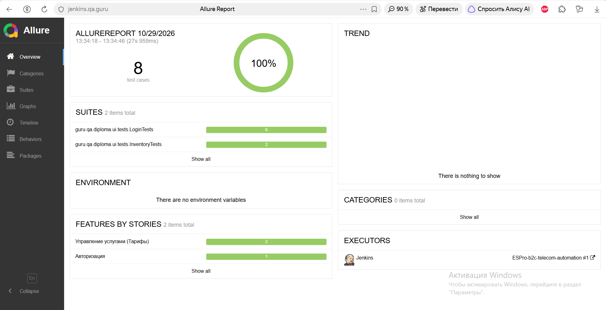
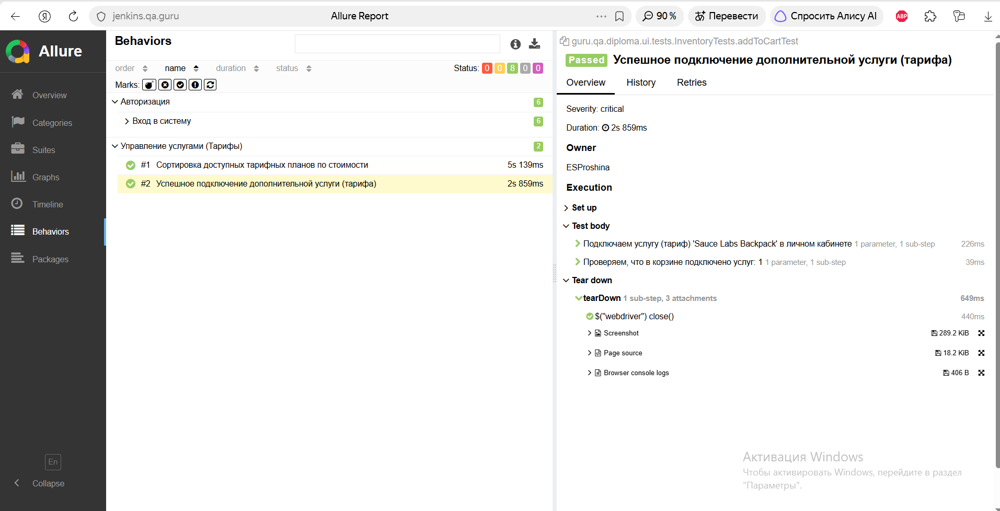

# B2C Telecom Automation (Дипломный проект QA.GURU)

Комплексный фреймворк для автоматизации тестирования B2C-портала телеком-компании (UI, API, Mobile).

> **Бизнес-контекст:** Проект демонстрирует подходы к тестированию личного кабинета абонента (управление тарифами, подключение услуг). Ввиду политик безопасности внутренние стенды операторов связи недоступны, поэтому UI-тесты написаны на открытый демо-стенд `saucedemo.com`, а бизнес-сценарии стилизованы под телеком-компанию.

## 🛠 Стек технологий
* **Java 21**
* **Selenide** (UI-автоматизация)
* **JUnit 5** (тестовый фреймворк, параметризация)
* **Gradle** (сборка)
* **Allure Report** (отчетность)
* **Jenkins + Selenoid** (CI/CD)

## 🚀 Блок 1: UI-тесты (Реализовано)
* Параметризованный тест авторизации (6 сценариев: успешный вход, заблокированный пользователь и др.).
* Тесты бизнес-логики: подключение услуги (добавление в корзину) и сортировка тарифных планов.
* Архитектура: **Page Object Pattern**.
* В Allure прикрепляются артефакты (скриншоты, логи).

### 📸 Скриншоты Allure Report

---
**Автор:** Елена Прошина