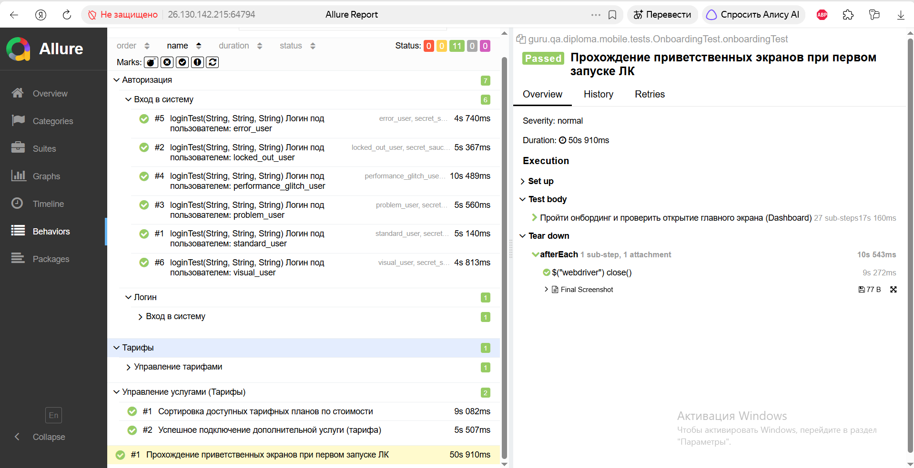

# B2C Telecom Automation (Дипломный проект QA.GURU)

Комплексный фреймворк для автоматизации тестирования B2C-портала телеком-компании. Проект объединяет в себе **UI**, **API** и **Mobile** тесты в рамках одного продукта.

> **Бизнес-контекст:** Проект демонстрирует подходы к тестированию личного кабинета абонента (управление тарифами, подключение услуг, мобильное приложение). Ввиду политик безопасности внутренние стенды операторов связи недоступны, поэтому используются открытые демо-стенды, а бизнес-сценарии стилизованы под телеком-компанию.

## 🛠 Стек технологий
* **Java 21**
* **Selenide** (UI-автоматизация)
* **Selenide-Appium + Appium Java Client** (Mobile-автоматизация)
* **REST Assured** (API-тестирование)
* **JUnit 5** (тестовый фреймворк, параметризация)
* **Gradle** (сборка проекта)
* **Allure Report** (отчетность и вложения)
* **Jenkins + Selenoid** (CI/CD)

## 🚀 Реализованные блоки

### Блок 1: UI-тесты (Web)
* Параметризованный тест авторизации (6 сценариев: успешный вход, заблокированный пользователь и др.).
* Тесты бизнес-логики: подключение услуги (добавление в корзину) и сортировка тарифных планов.
* Архитектура: **Page Object Pattern**.
* В Allure прикрепляются артефакты (скриншоты, логи).

### Блок 2: API-тесты
* Настроены модели запросов/ответов (Jackson) и спецификации (RequestSpecification).
* Тесты создания сущности (тарифа) и авторизации.
* Валидация ответов через `JsonPath` и проверка статус-кодов.
* Подключен `AllureRestAssured` для логирования запросов в отчет.

### Блок 3: Mobile-тесты
* Автоматизация мобильного приложения абонента (на базе Android APK).
* Настроен `AndroidDriverProvider` для работы с локальным эмулятором (Appium) и облачной фермой (BrowserStack).
* Тест прохождения приветственных экранов (Onboarding) и проверка загрузки главного экрана.
* Архитектура: **Screen Object Pattern**.

## 📸 Скриншоты

### Общий вид Allure Report (все блоки)

### Детализация UI-тестов 

### Мобильные тесты (Onboarding)

### Jenkins Job (Сборка)
!https://jenkins.qa.guru/view/java-students/job/ESPro-b2c-telecom-automation/

---
**Автор:** Елена Прошина (QA Automation Engineer)